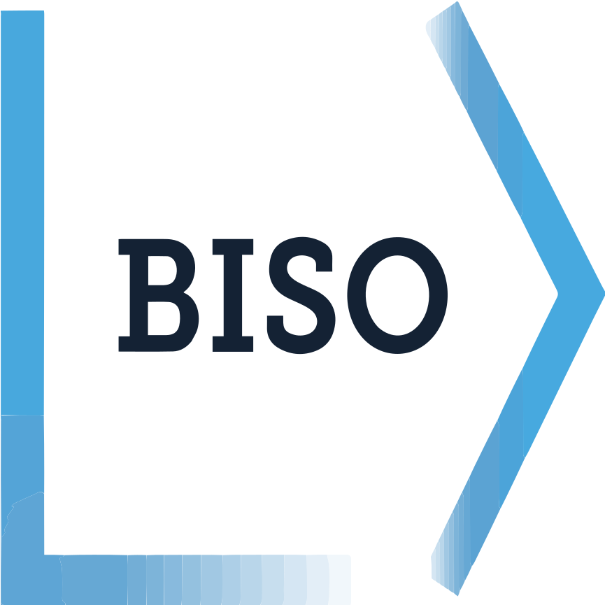

<div align="center">

<picture>
  <source media="(prefers-color-scheme: dark)" srcset="./logo-dark.png">
  <source media="(prefers-color-scheme: light)" srcset="./logo-light.png">
  
</picture>

### The student organisation for BI Norwegian Business School

[](https://biso.no)
[](mailto:contact@biso.no)

</div>

---

## About

BISO (BI Student Organisation) represents and serves students across BI's four campuses: **Oslo, Bergen, Trondheim and Stavanger**. We run events, student services, a web shop, volunteer positions and much more, and we rely on a digital platform to keep all of it running.

This GitHub organisation is home to the code behind that platform, built and operated in-house by BISO's IT function.

## Open source projects

| Repository | Description | Stack |
|---|---|---|
| [**BISO-Sites**](https://github.com/biso-no/BISO-Sites) | The unified web platform behind [biso.no](https://biso.no): news, events, products and payments, recruitment, reimbursements, a page editor and an admin center | TypeScript, React, Next.js, Appwrite |
| [**BISO-Flutter**](https://github.com/biso-no/BISO-Flutter) | The BISO mobile app: events, web shop, volunteer positions, membership and expense reimbursements | Flutter, Appwrite |

The web platform and the app share one backend, so a user, an order or a reimbursement looks the same everywhere.

## How it fits together

```
        ┌──────────────┐     ┌──────────────┐
        │ BISO-Sites   │     │ BISO-Flutter │
        │ (Next.js)    │     │ (Flutter)    │
        └──────┬───────┘     └──────┬───────┘
               │   shared backend   │
               └────────┬───────────┘
                        ▼
                ┌───────────────┐
                │   Appwrite    │  auth · database · storage
                └───────┬───────┘
          ┌─────────────┼──────────────┐
          ▼             ▼              ▼
     Accounting     Vipps Checkout   Microsoft 365
   (24SevenOffice)    (payments)    (SharePoint, Teams)
```

## Highlights

- **One platform instead of many.** Content, events, payments, recruitment and reimbursements live in a single system.
- **AI where it helps.** Receipt reading and cost-center suggestions for reimbursements, an assistant that answers questions about BISO, and an admin assistant, all running on Anthropic's Claude models. Accounting approval stays in the loop.
- **Simple payments.** Payments are consolidated on Vipps Checkout.
- **Built for students.** Used across all four BI campuses.

## Tech stack

**Web:** TypeScript, React, Next.js  
**Mobile:** Flutter  
**Backend:** Appwrite (auth, database, storage), Node.js  
**Infrastructure:** Docker, self-hosted servers with nightly backups  
**Microsoft ecosystem:** Microsoft 365, SharePoint, Power Automate, Azure Automation, Microsoft Graph  
**Integrations:** 24SevenOffice, Vipps, Anthropic API

## Contributing

Found a bug or have an idea? Open an issue in the relevant repository. Pull requests are welcome; for larger changes, please open an issue first so we can discuss the approach.

BISO volunteers and board members who want to work on the platform are welcome to reach out to IT for access and setup help.

## Security

Found a vulnerability? Please **do not** open a public issue. Email [it@biso.no](mailto:it@biso.no) and we'll get back to you.

## Contact

| | |
|---|---|
| General | [contact@biso.no](mailto:contact@biso.no) |
| IT and technical | [it@biso.no](mailto:it@biso.no) |
| Web | [biso.no](https://biso.no) |

---

<div align="center">
<sub>Built by students, for students. © BI Student Organisation</sub>
</div>
